# UAV-RR-Jammer-FDTD

Electromagnetic simulation of a portable 2.4 GHz RF jammer and its coupling into a drone's Wi-Fi link antenna,
for four jammer antenna designs.

This repository contains the simulation work of the UREP project **"Design and Optimization of a Portable
Electromagnetic Gun for Targeted RF Signal Suppression"** (UREP 32-0123-250016), carried out at Qatar University
under the supervision of [Dr. Amith Khandakar](https://sites.google.com/view/amith-khandakar/about).

## What this simulation does

A jammer is only as effective as the power it delivers to the target radio, and that depends on the antenna as much
as on the transmitter. This simulation places a jammer near a 2.4 GHz drone Wi-Fi antenna and computes, with a
full-wave electromagnetic solver, how much of the jammer's power reaches the drone's receiver for four different
jammer antennas.

For each antenna design it answers three questions:

1. **How well does the antenna radiate, and in which direction?** Match (S11), realized gain and 3D radiation pattern.
2. **How much power reaches the drone's antenna?** Coupling from the jammer feed to the drone antenna terminals,
   at 0.1, 0.5, 1 and 2 m.
3. **Is that enough to jam the link?** The jamming-to-signal ratio (J/S) at the drone receiver.

The solver is [openEMS](https://openems.de), a free finite-difference time-domain (FDTD) code, driven from MATLAB or
GNU Octave. Results are post-processed in MATLAB and Python and can be viewed in a web browser or in ParaView.

## The four jammer designs

The drone antenna (called the TX in the code) is the same in every stage: a 52.2 mm vertical dipole, 0.5 m above a
metal ground, transmitting 20 dBm. Only the jammer antenna changes. The jammer stands at the same height, aimed at
the TX, and feeds 30 dBm into its antenna.

| | |
|---|---|
| 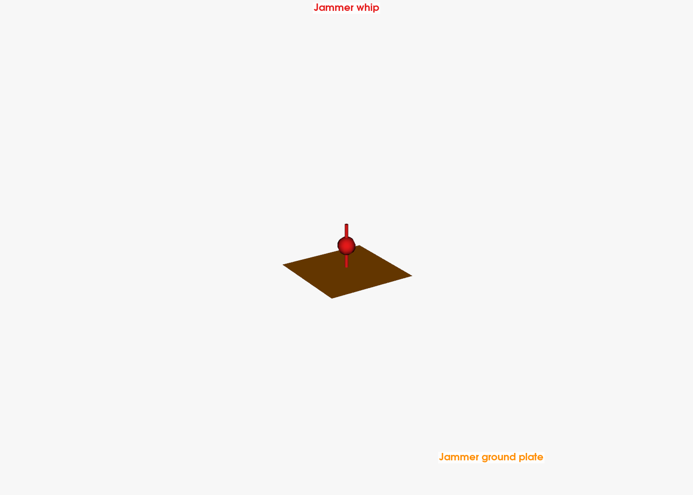 | 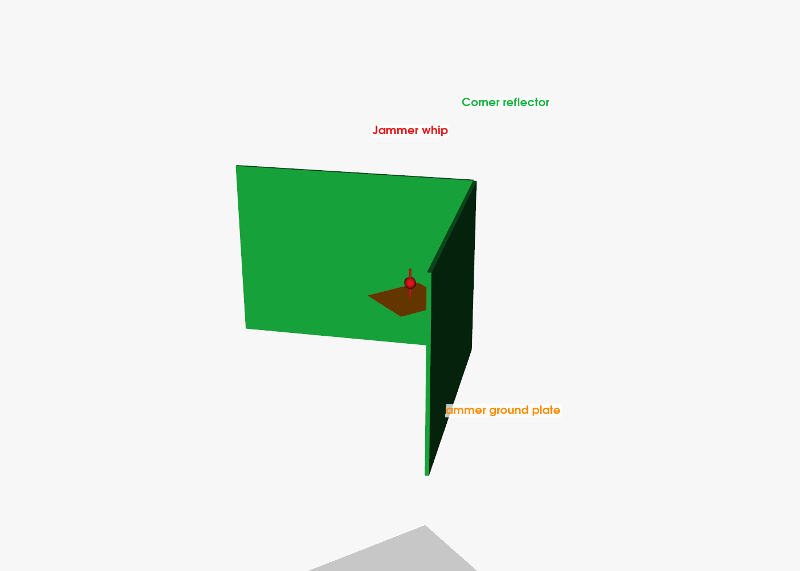 |
| **Stage A:** bare omnidirectional whip, 24.1 mm on a 50 mm ground plate | **Stage B:** the same whip in a 90° corner reflector (S 60 mm, L 200 mm, H 150 mm) |
|  | 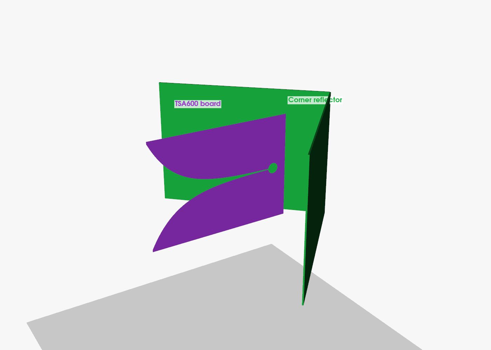 |
| **Stage C:** RFSPACE TSA600 Vivaldi antenna, 330 x 240 mm board | **Stage D:** the TSA600 with a 90° corner reflector behind it (S 120 mm, L 400 mm, H 300 mm) |

A complete scene, here Stage D with the TX (blue) 0.1 m in front of the jammer:

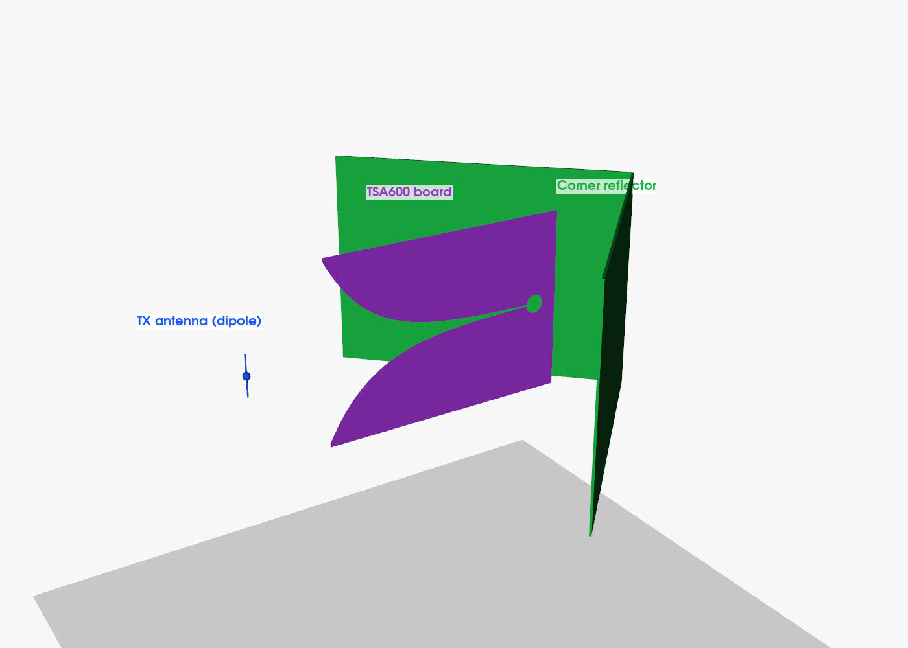

## Results

All values are at 2.4 GHz. They are simulated, not measured, and depend on the assumptions listed further down.

### Antenna gain and beam

Radiation pattern of each jammer antenna on its own, in free space. The arrow points towards the TX.

| | |
|---|---|
| 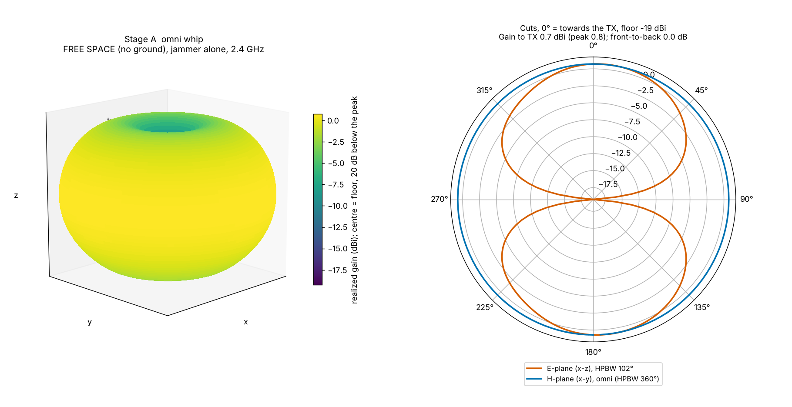 | 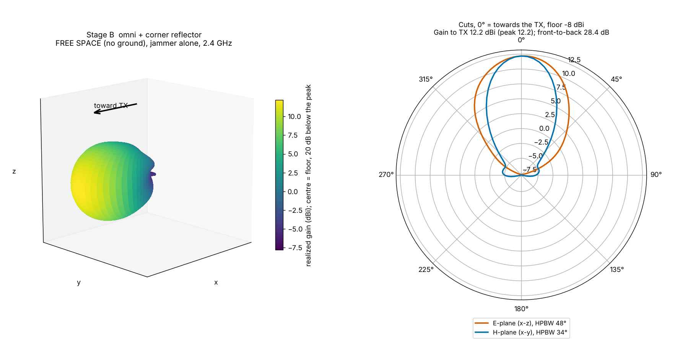 |
| 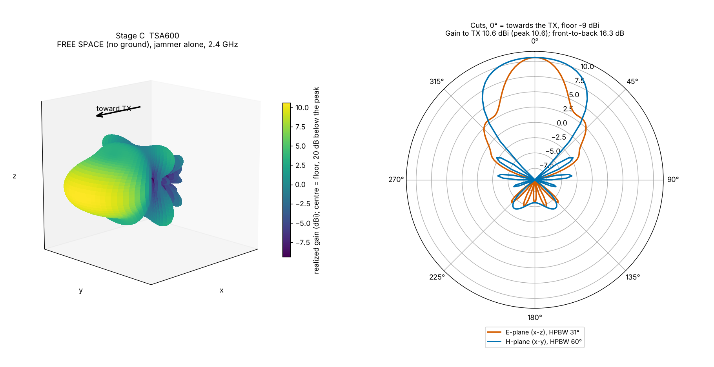 | 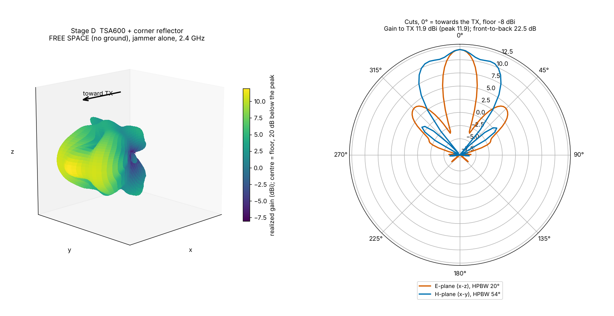 |

| Stage | Gain towards the TX (dBi) | Front-to-back (dB) | Beamwidth, vertical (deg) | Beamwidth, horizontal (deg) |
|---|---|---|---|---|
| A | 0.72 | 0.0 | 102 | 360 |
| B | 12.19 | 28.4 | 48 | 34 |
| C | 10.61 | 16.3 | 31 | 60 |
| D | 11.95 | 22.5 | 20 | 54 |

Source: `results/compare_all/pattern_summary_free.csv`.

### Power reaching the drone antenna

Coupling is the fraction of the jammer's power that arrives at the drone antenna terminals, in dB. The jamming power at
the receiver is J = 30 dBm + coupling, and J/S = J - 20 dBm.

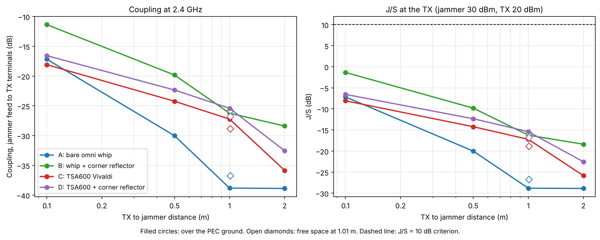

| Distance | Stage A | Stage B | Stage C | Stage D |
|---|---|---|---|---|
| 0.1 m | -17.2 dB | -11.4 dB | -18.1 dB | -16.6 dB |
| 0.5 m | -30.0 dB | -19.8 dB | -24.2 dB | -22.3 dB |
| 1 m | -38.8 dB | -26.2 dB | -27.2 dB | -25.4 dB |
| 2 m | -38.9 dB | -28.4 dB | -35.8 dB | -32.5 dB |
| 1.01 m, free space | -36.8 dB | -25.8 dB | -28.9 dB | -26.8 dB |

Source: `results/stage<X>/stage<X>_table.csv`. Coupling is over the metal ground unless marked free space.

### Electric field around the jammer

Field strength in the horizontal plane through the antennas, with the TX (white triangle) 0.1 m from the jammer.

| | |
|---|---|
| 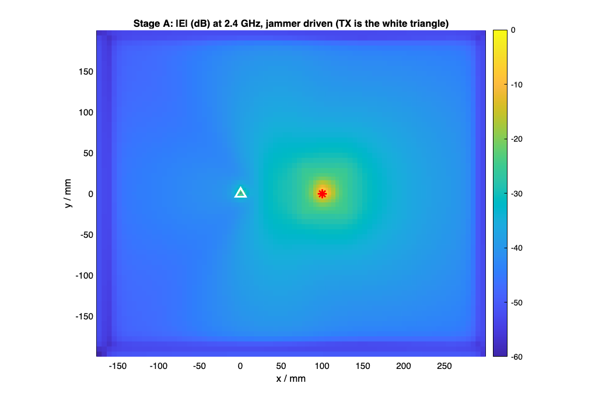 | 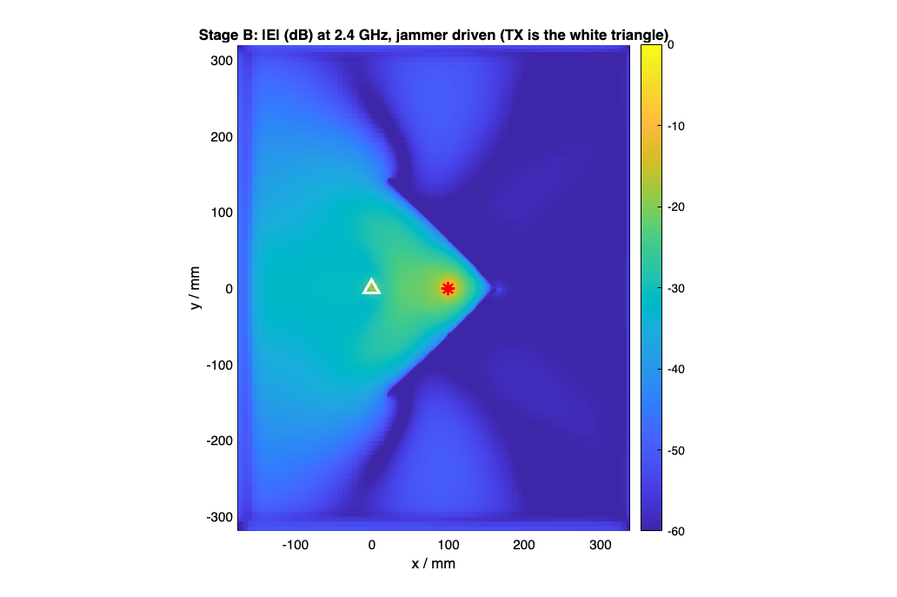 |
| 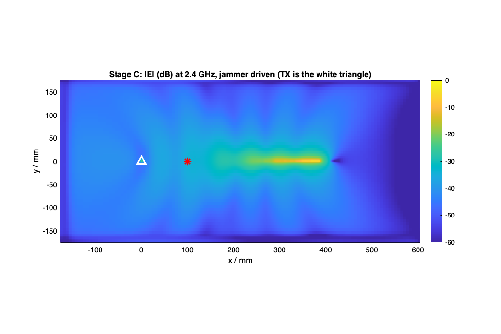 | 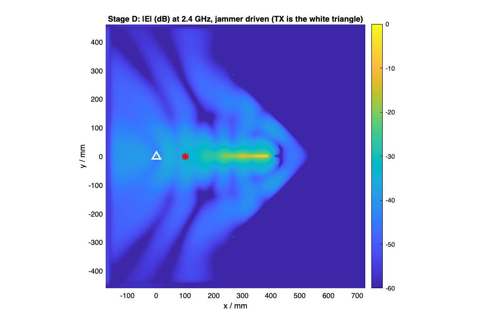 |

### Main observations

- The directional designs (B, C, D) put about 10 to 11.5 dB more gain towards the TX than the bare whip (A).
- Stage B, the whip in a corner reflector, has the highest gain and the strongest coupling at 0.1, 0.5 and 2 m.
  Stage D is about 0.8 dB stronger at 1 m and has the narrowest vertical beam (20°).
- Adding the corner reflector to the TSA600 (Stage C to D) raises its gain by only 1.3 dB.
- With 30 dBm into the jammer and 20 dBm from the TX, J/S cannot exceed +10 dB, however good the coupling.

## How to see the results

**In a web browser.** Each stage has one summary page with its text report and every figure. Open it from the
repository folder:

```bash
open results/stageA/index.html          # macOS
xdg-open results/stageA/index.html      # Linux
```

GitHub shows `.html` files as source code, so clone or download the repository and open the pages locally. All PNG
figures can also be viewed directly on GitHub in `results/stage<X>/plots/`.

**In a spreadsheet.** `results/stage<X>/stage<X>_table.csv` has one row per distance (coupling, J, J/S),
and `stage<X>_spectra.csv` has S11 and S21 from 2.0 to 2.8 GHz.

**In ParaView.** The 3D radiation patterns are in `results/stage<X>/patterns3d/*.vtk` and
`results/compare_all/pattern3d_free_stage<X>.vtk`. Open a file, click Apply and colour by the gain array.

What each result folder holds:

| Path | Content |
|---|---|
| `results/stage<X>/index.html` | Summary page: report and all figures for that stage |
| `results/stage<X>/report_stage<X>.txt` | S11, impedance, gain, coupling, J, J/S and required TX power at each distance |
| `results/stage<X>/plots/` | Geometry, S11 and VSWR, 2D and 3D patterns, coupling and J/S versus frequency and distance, field map |
| `results/stage<X>/geometry_pictures/` | Rendered views of the TX, the jammer and the scene |
| `results/stage<X>/patterns3d/` | 3D patterns for ParaView |
| `results/geometry/` | Ready-made 3D geometry of the TX, each jammer and each scene, for ParaView and AppCSXCAD |
| `results/compare/` | All four stages on one plot |
| `results/compare_all/` | Free-space 3D patterns of all four jammers and their summary table |
| `report/` | The full simulation report (PDF) |

## Running the simulation

See [HOW_TO_RUN.md](HOW_TO_RUN.md) for the software needed, how to run each stage, how long it takes, and how to change
the antennas or re-run a stage. In short, with openEMS and MATLAB installed:

```bash
./run_stage.sh A        # replace A with B, C or D
```

## Main assumptions

- **Jammer power.** 30 dBm (1 W) at the antenna port, all inside one 20 MHz Wi-Fi channel. This is a normalized
  reference: the model is linear, so gains and patterns do not depend on it, and every absolute level (J, EIRP, J/S)
  shifts dB for dB with it. The datasheet of the reference jammer (JH-HB8, channel 5) gives about 27 dBm.
- **Drone antenna.** A generic 52.2 mm half-wave dipole tuned for 2.4 GHz, standing in for the drone's Wi-Fi antenna,
  transmitting 20 dBm.
- **Ground.** An infinite perfect metal plane, 0.5 m below both antennas. One extra run at 1.01 m has no ground.
- **Gain** is realized gain (port mismatch included). **EIRP** towards the TX is taken as the port power plus that gain.
- **Coupling** is reported with both ports assumed perfectly matched (their mismatch loss is removed from S21).
- **Cables.** None in the simulation: the receiver sits directly at the antenna terminals. Where simulated levels are
  compared with laboratory measurements, a cable loss of 1.0 dB is assumed for the measurement chain; this value was
  not measured.
- **Jamming criterion.** The link is counted as jammed at J/S of 10 dB or more.

## Limitations

- The TSA600 is modelled as a thin metal sheet without its circuit board material, fed by an ideal lossless 125 Ω port.
  A real balun, connector and cable add loss, so Stages C and D are somewhat optimistic.
- Real floors, walls and the laboratory enclosure are not modelled.
- No mesh convergence study or direct comparison with a measured pattern has been carried out yet.

## Repository layout

```
.
├── README.md               This page
├── HOW_TO_RUN.md           Requirements, running, modifying
├── C1_antenna_check.m      Step 1: each antenna alone
├── C2_run_scene.m          Step 2: jammer and TX together at each distance
├── C3_postprocess.m        Step 3: coupling, J/S, report and tables
├── C4_make_report.m        Step 4: figures, 3D patterns and index.html
├── G_geometry.m            Geometry only, no simulation
├── run_stage.sh            Runs steps 1 to 4 for one stage
├── run_geometry.sh         Writes the geometry files for viewing
├── open_geometry.sh        Opens a geometry case in ParaView
├── setup_paths.m           Finds openEMS
├── plot_cases.py           Extra figures from the CSV files
├── params/                 All inputs: TX, jammer, receiver, frequency, mesh, distances
├── lib/                    Model builders and helper functions
├── tools/                  compare_stages.py: the all-stage comparison plots
├── docs/                   Geometry viewing guide; archive/ holds the original per-stage notes
├── results/                Results of stages A to D (summary), plus ready-made geometry files
├── report/                 Simulation report (PDF)
├── CITATION.cff            Citation metadata (GitHub shows a "Cite this repository" button)
└── LICENSE                 To be chosen
```

## Citation

If you use this code, please cite:

```bibtex
@misc{uav_rf_jammer_fdtd,
  author       = {Dr. Amith Khandakar, Fahad Abdelshafi Ali},
  title        = {Design and Optimization of a Portable Electromagnetic Gun for Targeted RF Signal Suppression:
                  Simulation},
  year         = {2026},
  institution  = {Qatar University},
  note         = {UREP 32-0123-250016},
  howpublished = {\url{https://github.com/OWNER/uav-rf-jammer-fdtd}}
}
```

## License

MIT License

Copyright (c) 2026 [Your Name], Qatar University

Permission is hereby granted, free of charge, to any person obtaining a copy
of this software and associated documentation files (the "Software"), to deal
in the Software without restriction, including without limitation the rights
to use, copy, modify, merge, publish, distribute, sublicense, and/or sell
copies of the Software, and to permit persons to whom the Software is
furnished to do so, subject to the following conditions:

The above copyright notice and this permission notice shall be included in all
copies or substantial portions of the Software.

THE SOFTWARE IS PROVIDED "AS IS", WITHOUT WARRANTY OF ANY KIND, EXPRESS OR
IMPLIED, INCLUDING BUT NOT LIMITED TO THE WARRANTIES OF MERCHANTABILITY,
FITNESS FOR A PARTICULAR PURPOSE AND NONINFRINGEMENT. IN NO EVENT SHALL THE
AUTHORS OR COPYRIGHT HOLDERS BE LIABLE FOR ANY CLAIM, DAMAGES OR OTHER
LIABILITY, WHETHER IN AN ACTION OF CONTRACT, TORT OR OTHERWISE, ARISING FROM,
OUT OF OR IN CONNECTION WITH THE SOFTWARE OR THE USE OR OTHER DEALINGS IN THE
SOFTWARE.

## Acknowledgements

This work was carried out under the Undergraduate Research Experience Program (UREP), project UREP 32-0123-250016,
at Qatar University, supervised by [Dr. Amith Khandakar](https://sites.google.com/view/amith-khandakar/about).
